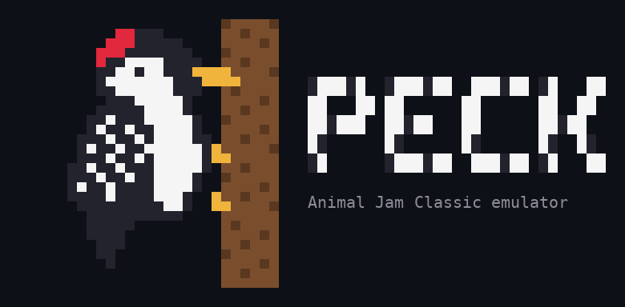

<p align="center">
  
</p>

<p align="center">Peck is an open source server emulator for Animal Jam Classic, written in TypeScript with Bun.</p>

## Contents

- [Only for fun/education purposes](#only-for-funeducation-purposes)
- [Features](#features)
- [Running it](#running-it)
- [Limitations](#limitations)
- [Contributing](#contributing)
- [Disclaimer](#disclaimer)
- [License](#license)

## Only for fun/education purposes

Peck started as the emulator inside Phantom, a project built over a few months of spare time, and is now released on its own.

This is the TypeScript version, ported over with the copyrighted stuff taken out. It still gets worked on when there's time.

Anyone can use it. If a few people learn how emulators work from it, that's good enough.

## Features

- [x] login and first animal
- [x] animals, colours and name bars
- [x] rooms and chat
- [x] clothes
- [x] dens and den layouts
- [x] den shops
- [x] shops and recycling
- [x] currency exchange, gem donations and diamond bundles
- [x] buddies and blocking
- [x] pets
- [x] trading
- [x] parties
- [x] minigames, pvp and multiplayer
- [x] jam-a-grams
- [x] masterpieces
- [x] jammer wall
- [x] ajhq cards
- [x] achievements
- [x] daily spin
- [x] reports, bans, mutes and kicks
- [x] clustering
- [x] plugins

## Running it

You'll need Bun, PostgreSQL and Redis. Fill in `.env.local` from `.env.example`, then:

```sh
bun install
bun run db:migrate
bun peck content:import
bun run db:seed
bun run dev
```

I won't help you find the content. The importer is there, and if you're smart enough you'll figure out the rest.

## Limitations

- No chat filter. Phantom had one, but I'm not releasing that part. It's easy enough to write your own if real people are going to use your server.
- I built masterpieces to use an S3 bucket, so you'll have to set one up yourself.
- This was built for client build `1829`.
- Adventures aren't built because I didn't see the point in them.
- None of Phantom's custom features are in here. That's for you to build yourself.

## Contributing

PRs are welcome, just:

- test what you change, with tests or by trying it in game
- stick to the code style
- no game files or assets

## Disclaimer

Peck isn't affiliated with or endorsed by WildWorks. Animal Jam is their trademark.

Everything here is my own code. There are no game files, assets or client patches in this repo, and I don't run a server.

If something here is yours and you've got a problem with it, open an issue and I'll sort it.

## License

Copyright (C) 2026 Sxip

Peck is free software under the [GNU Affero General Public License v3.0](LICENSE) or any later version. If you run a modified version as a server, you must make its source available to its players.
